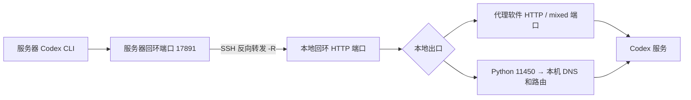

# 本地 Codex 连接服务器 Codex CLI

**让 GPU 服务器上的 Codex CLI，通过 SSH 反向隧道共享本地电脑的网络出口。**

Agent skill for sharing a local HTTP proxy or a directly reachable network with a remote Codex CLI over an SSH reverse tunnel. Python standard library only; Windows local machine + Linux GPU server.

大学生、研究生常在 AutoDL 等平台租用 GPU 训练模型。某些服务器的网络无法连接 Codex 服务，而自己的电脑具备可用的代理软件或网络。本项目把配置过程整理成可复用的 skill，附带端口转发、代理配置、验证和回滚脚本。

它共享的是网络出口。Codex CLI 仍然运行在服务器上，直接处理服务器上的代码、数据和训练任务；本地 Codex 和服务器 Codex 不会因此共享对话或账号登录状态。

## 两种方案

| 本地条件 | 本地 HTTP 端口 | 是否运行 Python 转发器 |
| --- | --- | --- |
| 有可用的代理软件 | 软件的 HTTP / mixed 端口，例如 `7890` | 不需要，SSH 直接转发到软件端口 |
| Wi-Fi / VPN / 系统路由本身能访问目标服务 | 本项目监听 `11450` | 需要运行 `local_forward.py` |

Wi-Fi 方案的脚本使用操作系统的 DNS 和路由，不会指定某块网卡。只有浏览器能访问、命令行不能访问时，优先检查是否用了浏览器专用代理；这不满足“本地网络直连”的前提。纯 SOCKS5 端口不能当成 HTTP 代理端口。



SSH 连接由本地电脑发起。`-R` 左边的监听地址在服务器，右边的目标地址在本地电脑。无需给服务器开放公网代理端口。HTTPS / WSS 经 HTTP CONNECT 透传，TLS 仍由客户端校验。

## 准备条件

- 本地：Windows PowerShell、OpenSSH 客户端（`ssh -V`）、可访问目标服务的出口。直接网络方案还需要 Python 3.9+。
- 服务器：Linux、SSH 允许远程 TCP 转发、Python 3.9+（使用附带配置脚本时）、已安装 Codex CLI（`codex --version`）。
- 从租赁平台获得自己的 SSH 主机、SSH 连接端口、用户名。示例中的主机和端口都应替换为自己的参数。
- Codex 需要独立有效的登录或 API 凭据。网络通道不解决账号权限、额度和服务地区支持问题。

## 安装这个 skill

使用 Skills CLI 一条命令安装到 Codex（需要 Node.js 18+ 和可访问 GitHub 的网络）：

```powershell
npx skills add Dushiqi1987/codex-remote-bridge --skill codex-remote-bridge -g -a codex -y
```

也可以克隆后手动安装：

```powershell
git clone https://github.com/Dushiqi1987/codex-remote-bridge.git
```

克隆或下载此仓库后，将**整个文件夹**复制到 Codex 的 skill 目录；保持脚本和参考文档一起安装。

Windows 本地示例（在仓库的父目录执行；目标已存在时先检查，避免覆盖）：

```powershell
Copy-Item -LiteralPath .\codex-remote-bridge -Destination "$env:USERPROFILE\.codex\skills\codex-remote-bridge" -Recurse
```

Linux 示例：

```bash
mkdir -p ~/.codex/skills
cp -R ./codex-remote-bridge ~/.codex/skills/
```

若你的客户端使用 `~/.agents/skills` 或自定义目录，将同一文件夹放到对应位置。新安装的 skill 在下一轮对话中可用；未显示时重新打开客户端。

可直接向本地 Codex 说：

> 使用 $codex-remote-bridge 帮我连接服务器上的 Codex CLI。我的 SSH 命令是 ssh -p 你的端口 root@你的主机；本地代理软件的 HTTP 端口是 7890。

或者：

> 使用 $codex-remote-bridge。我的本地网络能直接访问目标服务，请用 Python 监听 11450，把服务器 17891 反向转发到本地。

## 手动操作：三个窗口

以下本地命令均在仓库根目录执行。**步骤 1、2 的窗口需要保持运行，步骤 3 在单独的服务器 SSH 终端执行。**

### 1. 本地电脑：准备出口

**方案 A：本地代理软件。** 查看软件中的 HTTP 或 mixed 端口。假设为 `7890`，在本地 PowerShell 验证：

```powershell
curl.exe --noproxy "" --proxy http://127.0.0.1:7890 --connect-timeout 10 --max-time 30 -I https://api.openai.com
```

不用启动本项目的 Python 转发器。下一步将隧道右侧端口改成 `7890`。

**方案 B：本地网络直接可访问。** 新开本地 PowerShell：

```powershell
python .\scripts\local_forward.py
```

看到 `Local HTTP proxy: http://127.0.0.1:11450` 后，在另一个本地窗口验证：

```powershell
curl.exe --noproxy "" --proxy http://127.0.0.1:11450 --connect-timeout 10 --max-time 30 -I https://api.openai.com
```

脚本支持 HTTP 请求方法和请求体、CONNECT、流式响应，以及 HTTP WebSocket Upgrade。HTTPS / WSS 的加密数据在 CONNECT 内传输。它没有 TLS 解密、上游 SOCKS 功能或全系统 VPN 功能。连接空闲超时默认 3600 秒，可用 `--idle-timeout` 调整；单次阻塞网络读写超时由 `--connect-timeout` 控制。

### 2. 本地电脑：建立 SSH 反向隧道

把 `12345` 替换为平台给你的 **SSH 连接端口**，主机替换为你的主机。下面的 `connect.nmb1.seetacloud.com` 仅沿用需求中的示例，不代表当前租赁实例。

直接网络方案：

```powershell
ssh -N -T -p 12345 -o ExitOnForwardFailure=yes -o ServerAliveInterval=30 -o ServerAliveCountMax=3 -R 127.0.0.1:17891:127.0.0.1:11450 root@connect.nmb1.seetacloud.com
```

代理软件方案（假设本地软件端口 `7890`）：

```powershell
ssh -N -T -p 12345 -o ExitOnForwardFailure=yes -o ServerAliveInterval=30 -o ServerAliveCountMax=3 -R 127.0.0.1:17891:127.0.0.1:7890 root@connect.nmb1.seetacloud.com
```

也可使用参数化脚本，先输出命令再运行：

```powershell
.\scripts\start_tunnel.ps1 -ServerHost connect.nmb1.seetacloud.com -SshPort 12345 -LocalPort 11450 -DryRun
.\scripts\start_tunnel.ps1 -ServerHost connect.nmb1.seetacloud.com -SshPort 12345 -LocalPort 11450
```

使用 SSH 密钥时加 `-IdentityFile 'C:\path\to\your-key'`。首次连接按平台提供的指纹核验主机，不使用 `StrictHostKeyChecking=no`。`-N -T` 表示只运行隧道，成功后没有服务器 shell、窗口安静等待是正常现象。`ExitOnForwardFailure` 检查远端监听能否建立，**不保证本地代理或最终服务已连通**。

若 PowerShell 阻止 `.ps1` 执行，直接使用上面的 `ssh` 命令即可。

### 3. 服务器：配置并显式加载代理

另开 SSH 终端进入服务器。推荐把脚本通过 `scp` 上传，避免服务器必须先联网下载仓库：

```powershell
scp -P 12345 .\scripts\configure_remote.py .\scripts\codex_with_proxy.py root@connect.nmb1.seetacloud.com:~/
```

然后在服务器执行：

```bash
python3 ~/configure_remote.py --dry-run
python3 ~/configure_remote.py
python3 ~/codex_with_proxy.py --check
```

配置脚本更新 `~/.codex/.env` 的六个代理变量，保留其他配置，并在更改已有文件前生成 `.env.backup-时间戳`。设置了 `CODEX_HOME` 时跟随该目录；也可显式传入 `--env-file /path/to/.env`。预览不会打印原文件中的凭据。

如果不上传脚本，可以按你的原始流程手动写入。以下 `cat >` 会覆盖文件，所以先备份已有文件；已有其他环境配置时使用上面的配置脚本更合适：

```bash
mkdir -p ~/.codex
if [ -e ~/.codex/.env ]; then
    cp -p ~/.codex/.env ~/.codex/.env.backup-$(date +%Y%m%d-%H%M%S)
fi
cat > ~/.codex/.env << 'EOF'
HTTP_PROXY="http://127.0.0.1:17891"
HTTPS_PROXY="http://127.0.0.1:17891"
NO_PROXY="localhost,127.0.0.1,::1"
http_proxy="http://127.0.0.1:17891"
https_proxy="http://127.0.0.1:17891"
no_proxy="localhost,127.0.0.1,::1"
EOF
chmod 600 ~/.codex/.env
```

**写入文件不等于当前进程获得环境变量。** 各版本和第三方封装可能有不同加载方式，因此此流程显式导出变量后启动 Codex，而不依赖 `.env` 自动加载。大小写同时设置，兼容不同 HTTP 客户端（例如 curl 对 HTTP 代理使用小写变量）。`HTTPS_PROXY` 的值也使用 `http://`，因为它指向 HTTP CONNECT 代理。

若 `.env` 是你自己管理的可信 shell 赋值文件，在服务器当前 shell 加载：

```bash
set -a
. ~/.codex/.env
set +a
```

如果不想执行 `.env` 内的 shell 内容，用附带启动器：它只读取代理键，不执行其他行，也不读取或转移认证文件。

```bash
python3 ~/codex_with_proxy.py
# 向 Codex 传递参数时，用 -- 分隔：
python3 ~/codex_with_proxy.py -- login status
```

## 验收：从网络到 Codex

在服务器依次执行：

```bash
# 远端代理监听应出现在回环地址（若是公网地址请先停止并检查 SSH 服务配置）：
ss -lnt | grep ':17891'

# 强制走指定代理，防止 NO_PROXY 绕过测试：
curl --noproxy '' --proxy http://127.0.0.1:17891 --connect-timeout 10 --max-time 30 -I https://api.openai.com

# 若在 shell 显式加载过 .env，验证当前环境中的代理也能生效：
curl --noproxy '' --connect-timeout 10 --max-time 30 -I https://api.openai.com

codex --version
codex login status
codex
```

也可以在启动器中运行 `login status`，再打开交互 Codex。未登录时按当前 CLI 帮助提供的登录方式操作；自己的账号凭据留在自己的服务器。向 Codex 发一个简单请求，例如“只回复连接成功，不读取或修改任何文件”，收到实际回复后才算 Codex 验收完成。

`HTTP/1.1 200 Connection Established` 只是 CONNECT 建立成功。还需要后面的目标服务响应；401/403/404 等 HTTP 状态只说明收到响应，仍需检查它是否来自目标服务、是否有代理拦截，以及账号是否可用。API 域名可达也不能证明所有登录域名、模型请求或 WebSocket 路径都可用。

## 停止与回滚

1. 本地 SSH 隧道窗口按 `Ctrl+C`。
2. 直接网络方案的 Python 窗口按 `Ctrl+C`。
3. 服务器按配置脚本输出的**实际备份路径**恢复 `.env`（例如 `cp -p 备份路径 ~/.codex/.env`）。如原来没有文件，移除新建文件前确认其中没有后来添加的配置。
4. 已加载变量的服务器 shell 中执行：

```bash
unset HTTP_PROXY HTTPS_PROXY NO_PROXY http_proxy https_proxy no_proxy
```

如原本有其他代理配置，恢复它们后重新加载；重新启动 Codex。正在运行的进程不会自动获得新环境。无需删除 `config.toml`、`auth.json` 或结束训练任务。

## 文件结构

```text
codex-remote-bridge/
├── SKILL.md                         Agent 工作流
├── README.md                        用户教程
├── agents/openai.yaml               Codex 展示信息
├── scripts/
│   ├── local_forward.py              本地 HTTP / CONNECT 转发器
│   ├── start_tunnel.ps1              SSH 反向隧道启动器
│   ├── configure_remote.py           服务器环境配置与备份
│   └── codex_with_proxy.py           显式携带代理环境启动 Codex
├── references/troubleshooting.md     故障排查
├── tests/test_bridge.py              本地离线协议与配置测试
└── evals/evals.json                  skill 行为测试场景
```

运行本地测试：

```powershell
python -m unittest discover -s tests -v
```

测试使用本机回环上的测试服务，验证代理的请求体、CONNECT、分块流式响应、Upgrade 和配置备份；不需要账号或真实服务器。测试通过不代表已经在你的 GPU 服务器上完成端到端验收。

## 故障排查与参考

详细排查见 [troubleshooting.md](references/troubleshooting.md)。本地电脑休眠、网络切换或 SSH 退出都会让服务器失去这个出口；重新启动监听和隧道即可恢复。

两端只绑定回环地址，但同一服务器上的其他用户仍可能访问回环端口。不要公开 `.env`、`auth.json`、API 密钥或 SSH 私钥。本项目不更改模型提供商、TLS 校验、Codex sandbox 或审批设置。

参考资料（核对日期：2026-10-12）：

- [Codex 官方配置基础](https://learn.chatgpt.com/docs/config-file/config-basic)：持久设置使用 `config.toml`。
- [Codex 官方环境变量说明](https://learn.chatgpt.com/docs/config-file/environment-variables)：环境变量用于进程和 shell 配置；该页面未对所有版本的 `.env` 自动加载或通用 HTTP 代理行为给出保证。
- [OpenSSH ssh 手册](https://man.openbsd.org/ssh)：`-R` 远程端口转发、`-N` 和 `-T`。
- [Vercel Skills](https://github.com/vercel-labs/skills) / [Find Skills](https://skills.sh/vercel-labs/skills/find-skills)：skill 发现与安装。
- [Anthropic Skill Creator](https://github.com/anthropics/skills/tree/main/skills/skill-creator)：skill 结构与验证方法参考。本仓库为独立编写，未打包这些第三方 skill 的代码。
